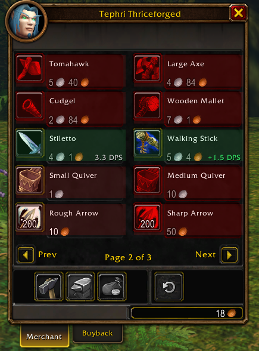
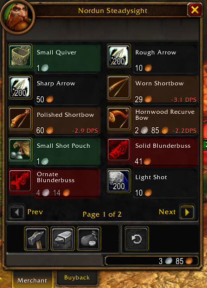
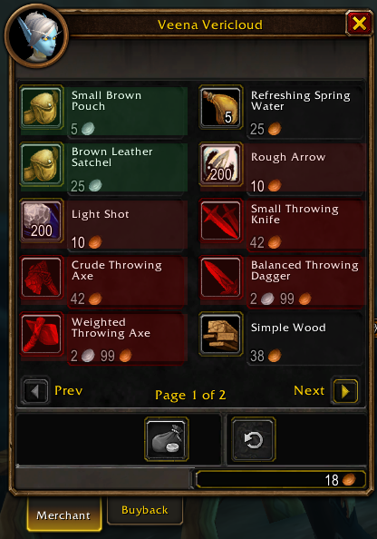
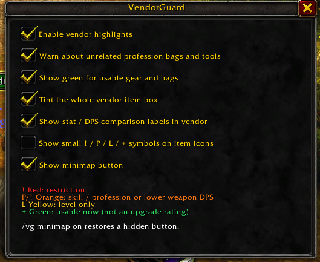

# VendorGuard

### Know before you buy.

Vendor highlights and compact gear comparisons for **World of Warcraft: Forever**.

**Version:** `0.3.0-beta.6` · **Interface:** `16001` · **Dependencies:** None

**[Download the beta](https://github.com/IronWolve/VendorGuard/releases/tag/v0.3.0-beta.6)** · [Report an issue](https://github.com/IronWolve/VendorGuard/issues)

VendorGuard adds subtle color fills to the default merchant window so you can spot unmet requirements, unrelated profession tools, and lower weapon DPS before spending your money. Optional comparison labels put the numbers directly beside vendor items. Open settings with the minimap button or `/vg`.

## See it in action

| Mage: weapon comparisons | Hunter: ranged comparisons |
| --- | --- |
|  |  |
| Walking Stick shows **+1.5 DPS** against the equipped staff. Stiletto shows its own **3.3 DPS** because switching to a dagger changes the weapon setup. | Lower-DPS bows show negative comparisons. Quivers and ammo pouches are usable; guns this character cannot currently use remain red. |

| Mage: bags and ammunition | Your settings |
| --- | --- |
|  |  |

## What the colors mean

| Color | Meaning |
| --- | --- |
| 🔴 **Red** | An unmet proficiency, class restriction, or other requirement. Also flags arrows, bullets, and ammo bags for classes that do not use them. |
| 🟠 **Orange** | Lower weapon DPS, a missing skill requirement, or a specialty bag/basic tool for a profession you do not have. |
| 🟡 **Yellow** | Higher character level is the only detected obstacle. |
| 🟢 **Green** | Gear or a bag you can use now. **Green is not an overall upgrade rating.** |

Requirement warnings take priority over DPS comparisons. Ordinary food and crafting materials stay neutral. Highlights have no added outlines, and VendorGuard never resizes the merchant window or its item rows.

## Comparisons at a glance

- **`+1.5 DPS` / `-3.1 DPS`** — weapon-DPS difference against equipped gear when a direct comparison is available.
- **`3.3 DPS`** — the weapon's own DPS, with no gain/loss claim. Used for hand-setup changes, two possible replacement hands, empty slots, or missing equipped data.
- **`+2 Agi` / `-1 Sta`** — a compact stat difference for other comparable equipment.
- **`L12: …`** — a comparison preview for an item whose level requirement you have not met.

Tight rows use compact text such as `+1.5DPS`. Labels sit beside the price or below the name; if both locations are full, the label is hidden rather than covering existing text. No hover is needed to see a displayed label.

These are base item comparisons, not character-DPS simulations or best-in-slot scores. Abilities, procs, set bonuses, and stat weights are not scored. If a weapon can replace either equipped hand, a DPS loss against either hand can trigger orange. Unknown DPS is never treated as zero.

Full stat-comparison tooltips are left to your other addons. VendorGuard adds only its requirement and warning explanations on hover. **Pawn is not required or used.**

## Profession and ammunition checks

Specialty bags warn orange when you lack their associated profession. Leatherworking storage bags accept either **Skinning or Leatherworking**. Ordinary bags do not require the profession that crafted them.

Basic tools are checked by item ID, not by matching words in their names:

| Tool | Relevant profession |
| --- | --- |
| Mining Pick | Mining |
| Skinning Knife | Skinning |
| Blacksmith Hammer | Blacksmithing or Engineering |

These basic tools do not display combat-DPS labels or receive DPS downgrade warnings. The orange warning indicates usefulness; it does not claim the tool is impossible to equip. Unknown profession data is not treated as a missing profession.

Quivers, ammo pouches, arrows, and bullets are recognized for **Hunters, Warriors, and Rogues**. Other current classes receive red warnings. Weapon training and item requirements still apply. This follows Forever's [bow](https://www.wowhead.com/forever/spell=2480/shoot-bow), [crossbow](https://www.wowhead.com/forever/spell=7919/shoot-crossbow), and [gun](https://www.wowhead.com/forever/spell=7918/shoot-gun) data.

## Install

1. Open the [v0.3.0-beta.6 release](https://github.com/IronWolve/VendorGuard/releases/tag/v0.3.0-beta.6) and download **`VendorGuard-0.3.0-beta.6.zip`** under **Assets**.
2. Extract the **`VendorGuard`** folder from that ZIP.
3. Place it in your Forever client's **`Interface/AddOns/`** directory.
4. Confirm that **`Interface/AddOns/VendorGuard/VendorGuard.toc`** exists, without an extra nested folder.
5. Enable **VendorGuard** in the game's AddOns list. If updating while the game is open, type **`/reload`**.

The install ZIP contains only the six runtime addon files. If you use GitHub's **Source code (zip)** download instead, rename its `VendorGuard-…` folder to `VendorGuard` before installing.

## Make it yours

**Left-click** the minimap button to open options, **right-click** to toggle highlights, and **drag** to reposition it.

Toggle vendor highlights, profession-bag/tool warnings, usable-item green fills, whole-entry tint, comparison labels, optional icon symbols, and the minimap button. Icon symbols are off by default.

| Command | Action |
| --- | --- |
| `/vg` | Open settings. |
| `/vg on` / `/vg off` | Enable or disable the addon. |
| `/vg compare on` / `/vg compare off` | Show or hide comparison labels. |
| `/vg minimap on` | Restore a hidden minimap button. |
| `/vg status` | Show addon/client versions and API availability. |
| `/vg debug N` | Show diagnostic details for vendor item N. |

## Compatibility and feedback

This beta targets **World of Warcraft: Forever's default merchant window**, interface `16001`. Other WoW clients and replacement merchant interfaces have not been validated. The tooltip-DPS fallback currently supports English clients.

Found a wrong color or missing comparison? [Open an issue](https://github.com/IronWolve/VendorGuard/issues) with the item name, character class/professions, `/vg status`, and a screenshot or Lua error. Remove personal information from anything you share.

VendorGuard is an independent community addon with no Blizzard endorsement. It does not automate purchases or gameplay.
